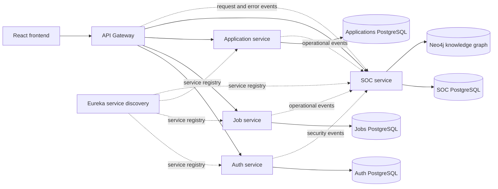

# Nextstep Recruitment Platform

A microservices recruitment application with candidate and recruiter workflows, plus an administrator-only Security Operations Centre (SOC). The SOC collects application events, detects selected security and service patterns, stores alert evidence in Neo4j, and answers supported questions from graph data.

## Features

### Recruitment

- Candidates can browse and filter opportunities, save roles, apply, and review their applications.
- Recruiters can publish opportunities, view applicants, and update application statuses.
- JWT authentication separates candidate, recruiter, and administrator experiences.

### Security operations

- The API Gateway, Auth, Job, and Application services emit security or operational events to the SOC.
- The SOC stores events and alerts in PostgreSQL and models connected evidence in Neo4j.
- Scheduled rules detect repeated failed logins, repeated unauthorized access, unusual request volume, service error spikes, and failed health checks.
- Administrators can view alerts and investigate them in the protected Security insights page.
- The RAG interface classifies supported questions, runs predefined Cypher queries, and returns template-based answers with the retrieved graph evidence and query method.

The RAG implementation is deterministic and graph-based. It does not use an LLM or vector embeddings.

## Architecture



The graph combines seeded application/security reference data with runtime event and alert evidence. Its main traceability path is `User → Event → Alert → Threat → Control/response procedure`.

## Technology

- Java and Spring Boot microservices
- Spring Cloud Gateway and Eureka
- PostgreSQL for service data and SOC events/alerts
- Neo4j 5 for the knowledge graph
- React 19 and Vite for the frontend
- Docker Compose for local services

## Prerequisites

- Docker Desktop with Docker Compose
- Node.js and npm to run the frontend development server

## Run locally

Run these commands from the directory containing `docker-compose.yml`:

```powershell
docker compose up --build -d
docker compose ps
```

The compose stack starts Eureka, the API Gateway, four backend services, four PostgreSQL databases, and Neo4j. Wait for the services to finish starting. Check SOC startup messages with:

```powershell
docker compose logs -f soc-service
```

Start the frontend in a second terminal:

```powershell
cd frontend
npm install
npm run dev
```

Open the Vite URL shown in the terminal, usually `http://localhost:5173`.

To stop the stack:

```powershell
docker compose down
```

## First administrator setup

Public registration only creates candidate and recruiter accounts. The first administrator is created through a one-time setup flow.

1. In the project root, create a local `.env` file and set a private setup key:

   ```dotenv
   ADMIN_SETUP_KEY=replace-with-a-long-random-value
   ```

2. Start or rebuild the services so the Auth service receives the value:

   ```powershell
   docker compose up --build -d
   ```

3. In the frontend login dialog, select **Set up the first administrator** and enter the administrator details and the same setup key.
4. After setup, sign in using that administrator account. The admin dashboard and Security insights are shown based on the account's `ADMIN` role.
5. Remove the setup key from `.env` and restart the Auth service after the initial account has been created.

The `.env` file is ignored by Git. Do not commit setup keys, passwords, tokens, or real credentials. The Compose file contains development database credentials; change them and the JWT signing secret before using this system beyond a local demonstration.

More detail: [ADMIN_SETUP.md](ADMIN_SETUP.md).

## Demonstrate the SOC and graph RAG

1. Sign in as an administrator and open **Admin dashboard → Security insights**.
2. Submit at least five failed logins for the same test email within five minutes using `POST /api/v1/auth/login`.
3. Allow the scheduled detection rule to run, then inspect the generated HIGH severity alert.
4. In Security insights, ask: **“Why was the latest alert created and what should be done?”**
5. Show the answer, retrieval method, and evidence nodes/relationships. The answer is produced from the current graph records and seeded mappings.

The failed login detector runs on a schedule; allow a short delay after the fifth attempt. Use a test account and avoid putting real credentials in screenshots.

See [DETECTION_RULES.md](DETECTION_RULES.md), [KNOWLEDGE_GRAPH_MODEL.md](KNOWLEDGE_GRAPH_MODEL.md), and [RAG_DEMONSTRATION.md](RAG_DEMONSTRATION.md) for thresholds, graph labels/relationships, queries, and demonstration steps.

## API quick reference

Base URL: `http://localhost:8080`

| Purpose | Method | Endpoint | Access |
|---|---|---|---|
| Gateway health | GET | `/health` | Public |
| Register candidate/recruiter | POST | `/api/v1/auth/register` | Public |
| One-time administrator setup | POST | `/api/v1/auth/admin-setup` | Setup key; first admin only |
| Sign in | POST | `/api/v1/auth/login` | Public |
| Current account | GET | `/api/v1/auth/me` | Bearer token |
| Browse jobs | GET | `/api/v1/jobs` | Public |
| List SOC alerts | GET | `/api/v1/soc/alerts` | Admin bearer token |
| List SOC events | GET | `/api/v1/soc/events` | Admin bearer token |
| Ask graph RAG | POST | `/api/v1/soc/rag/ask` | Admin bearer token |
| Graph evidence for alert | GET | `/api/v1/soc/graph/evidence-for-alert/{alertId}` | Admin bearer token |
| Graph dependency impact | GET | `/api/v1/soc/graph/dependency-impact?service=application-service` | Admin bearer token |

For SOC requests, the Gateway's public route prefix is `/api/v1/soc/`; it forwards to the SOC service's `/api/v1/` routes. Use the admin JWT returned by the login endpoint as a Bearer token.

Example RAG request body:

```json
{
  "question": "Why was the latest alert created and what should be done?"
}
```

More endpoints are listed in the controllers under `soc-service/src/main/java/com/recruitplatform/soc_service` and in the service controller directories.

## Neo4j

Neo4j Browser is available at `http://localhost:7474`. Use the database credentials configured in `docker-compose.yml` for the local demonstration. To visualize the graph schema:

```cypher
CALL db.schema.visualization();
```

To inspect connected runtime records:

```cypher
MATCH (n)-[r]-(m)
RETURN n, r, m
LIMIT 150;
```

## Known limitations

- Event delivery uses asynchronous HTTP with bounded queues; it is best-effort and does not provide durable replay.
- Detection thresholds are demonstration values and have not been calibrated against production traffic.
- Health monitoring uses service health endpoints and does not ingest Docker container state.
- RAG supports a fixed set of question patterns. Unsupported wording may not map to the intended query.
- Graph answers depend on runtime data and seeded relationships being present. A seeded threat or CWE reference is not proof that the application was scanned and found vulnerable.
- The prototype recommends responses but does not automatically block users, IP addresses, or services.

## Project documentation

- [Phase 2 report](output/docx/SOC_Phase2_Architecture_Design_Limitations_Evidence_Report.docx)
- [Phase 2 architecture and requirement coverage](PHASE2_REPORT.md)
- [Detection rules](DETECTION_RULES.md)
- [Knowledge graph model](KNOWLEDGE_GRAPH_MODEL.md)
- [RAG demonstration guide](RAG_DEMONSTRATION.md)
- [Administrator setup](ADMIN_SETUP.md)
